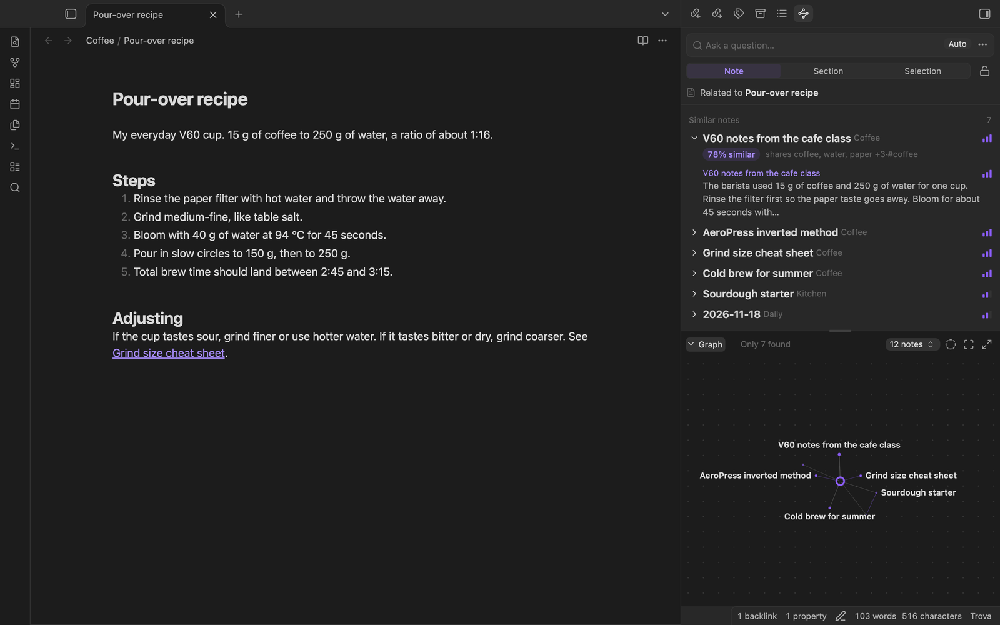
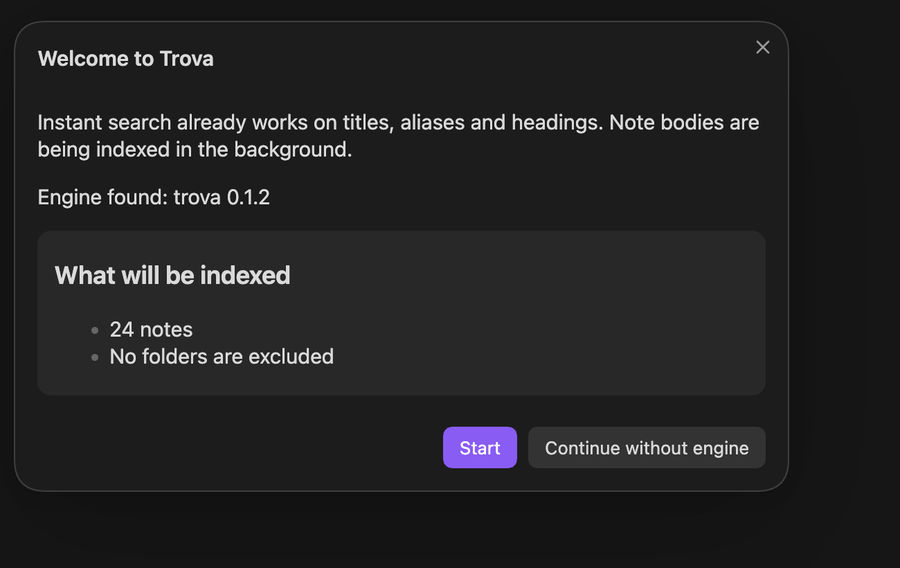
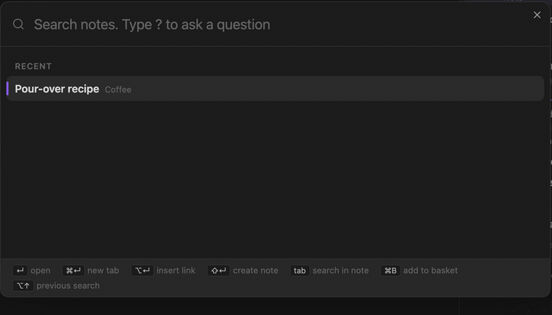
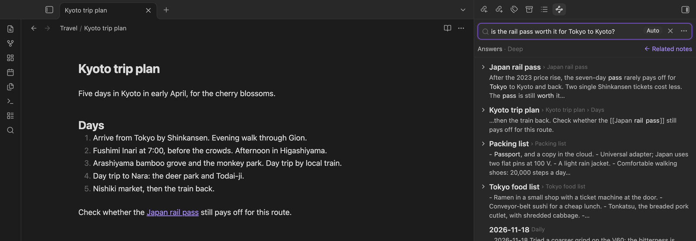
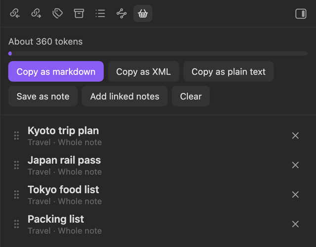
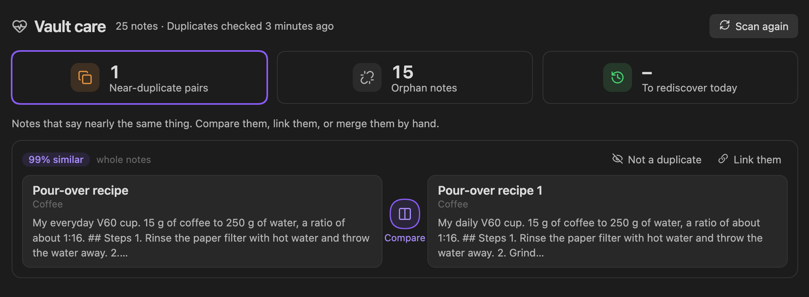
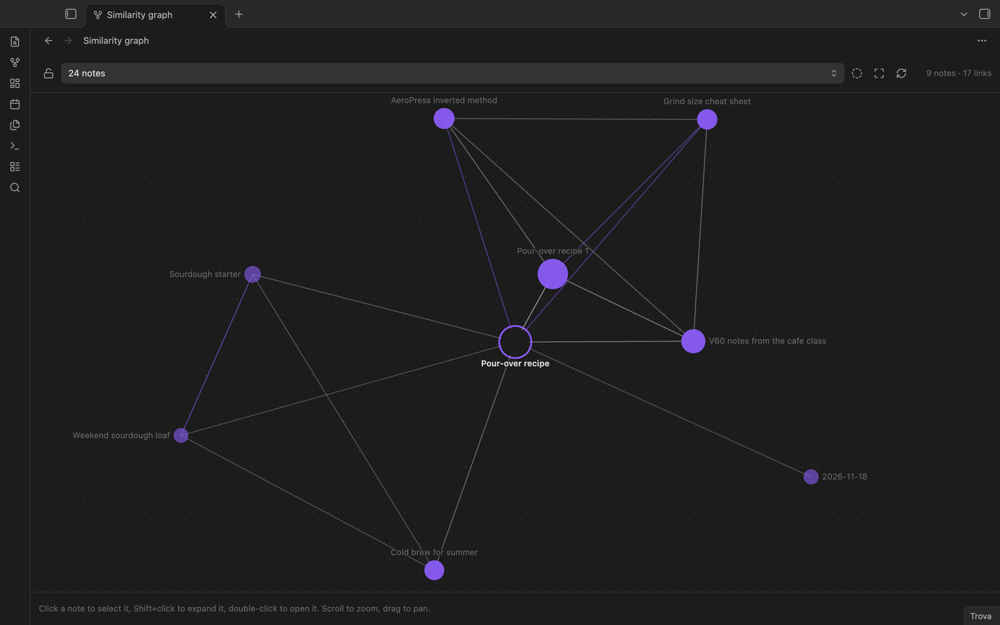

# Trova for Obsidian

[](https://community.obsidian.md/plugins/trova)
[](https://github.com/ibimal/trova-obsidian/releases/latest)

**Find notes by what they mean, not only by the words in them.** Trova shows the notes related to the one you are writing, answers questions from your vault, and finds notes you forgot you had. Everything runs on your own computer, and your notes never leave it.



## Quick start

1. Install the Trova engine, the program that does the searching. It needs [Node.js](https://nodejs.org) 22 or later. In a terminal, run:

   ```bash
   npm install -g trova-cli
   ```

2. In Obsidian, open **Settings → Community plugins → Browse**, search for **Trova**, choose **Install**, then **Enable**.

3. The welcome screen shows what Trova will index. Click **Start**. Instant search works at once. Related notes and Ask follow when the first index is done, which takes a few minutes for most vaults.



When the first index is done, a notice suggests hotkeys for Instant search and Ask. It suggests only combinations that no other command uses.

## What you can do

### Find any note as you type

Open **Instant search** from the command palette, or with its hotkey. Results update with each key you press. Trova corrects misspelled words, and you can search for exact words, phrases and `in:title`, or leave words out with `-word`. Press Enter to open a note. The hints at the bottom list the other keys, such as inserting a link or adding the note to the Context basket.



### See what's related while you write

The **Connections** pane lists the notes most similar to the one you are reading, most similar first. The bars show how close each note is. Expand a note to see the passage that matches. Switch to **Section** for notes related to the part of the note at your cursor, or to **Selection** for the text you have selected. The graph at the bottom shows how the related notes connect to each other.

The notes do not need links between them, because Trova compares what they say. In the picture at the top, a coffee recipe finds the notes from a coffee class, although neither note links to the other.

### Ask your vault a question

Type a question in the Connections pane's search box and press Enter. Trova answers with the passages that match best, ranked by keyword and by meaning. Press Enter again for a **Deep** search, which reads the best passages more closely and ranks them again. Deep search needs an extra download of about 1.7 GB, which Trova asks you about first. Esc goes back to the related notes.



### Collect context for an AI chat

The **Context basket** gathers whole notes and single sections. Add them from Instant search, from the Connections pane, or with the "Add current note" and "Add section at cursor" commands. The basket shows the estimated token count. Copy everything as Markdown, XML or plain text and paste it into the AI chat you use, or save it as a new note.



### Tidy your vault

**Vault care** finds near-duplicate notes, so you can compare them side by side, link them or merge them. It also lists orphan notes, which no other note links to, with suggestions for where they belong. If you turn on **Rediscover** in the settings, Vault care also picks old notes each day that are related to what you are working on now. Your choices, such as "Not a duplicate" and "Keep unlinked", are remembered, with Undo.



### Explore your vault visually

The **similarity graph** puts the active note in the centre, with its related notes around it and lines between the notes that are similar to each other. Shift-click a note to add its own related notes, and double-click it to open it. The **topic map** groups the whole vault by topic on one canvas that pans and zooms, even with thousands of notes.



### And more

- **Bases:** a view named "Trova related" adds a similarity Score column and a Related column to a base.
- **Folders outside the vault:** add them under **Settings → Trova → Outside folders**, and Instant search shows their files too. They open in your default app.
- **Text in images:** with the Text Extractor plugin installed, Trova also searches the text in your image attachments.
- **A local HTTP API** for your own scripts, off by default.

## Requirements

- Obsidian 1.13.4 or later, on a desktop computer. Obsidian on phones and tablets is not supported yet.
- The Trova engine, `trova-cli`, on the same computer, with Node.js 22 or later. Node 24 is the tested version.
- Trova is tested on macOS on Apple Silicon. Windows and Linux are not tested yet.

Without the engine, Instant search still works from the plugin's own keyword index, and Ask falls back to keyword matches and says so. Related notes, meaning-based results, the graphs and the near-duplicate scan need the engine.

The plugin looks for `trova` on your `PATH` and in the usual install folders. If it does not find it, set the path under **Settings → Trova → Engine binary path**.

## Privacy

Trova works entirely on your computer.

- **Your notes stay on your computer.** The plugin talks only to the engine on your own computer (`127.0.0.1`), with a token that only your user account can read.
- **The engine downloads its models once,** from Hugging Face, after you click Start: about 330 MB, and about 1.7 GB more for Deep search, which it downloads only after you confirm. The models have their own licences, listed in the [engine's README](https://github.com/ibimal/trova#models).
- **No telemetry.** The plugin and the engine collect no usage data and send nothing anywhere.

Obsidian also asks plugins to state these things:

- **It reads the files in your vault.** To build its index, the plugin lists the files in the vault and reads the text of the notes and attachments it indexes. It skips the folders you exclude, notes with `trova: false` in their frontmatter, and Obsidian's own excluded files.
- **Files outside the vault:** only if you add folders under **Settings → Trova → Outside folders**. The engine then indexes those folders too.
- **It runs a separate program.** The plugin starts the `trova` engine that you installed, as a background process. It never downloads or installs programs itself.
- **Clipboard:** the plugin only writes to the clipboard, when you choose a copy action: copying the basket, links, a saved search, the debug info or the install command. It never reads the clipboard.
- **Optional local HTTP API:** off by default. When you turn it on, the plugin serves read-only search, Ask and related-notes endpoints on `127.0.0.1`, protected by a token shown in the settings.
- **Image text:** if the Text Extractor plugin is installed and image attachments are indexed, Trova asks it for the text in your images and sends that text to the engine.

## Commands

Open the command palette and type "Trova". You can give any command a hotkey under **Settings → Hotkeys**; the plugin sets none itself.

| Command                                                                     | What it does                                               |
| --------------------------------------------------------------------------- | ---------------------------------------------------------- |
| Instant search                                                              | Search the vault as you type                               |
| In-file search                                                              | Search the open note                                       |
| Ask, Ask about selection                                                    | Ask a question about the vault, or about the selected text |
| Open Connections and Ask                                                    | Open the side pane                                         |
| Connections for selection                                                   | Related notes for the selected text                        |
| Random strong connection                                                    | Open a note closely related to the active one              |
| Open Context basket, Copy basket                                            | Show the basket, or copy its contents                      |
| Add current note to Context basket, Add section at cursor to Context basket | Fill the basket                                            |
| Open Vault care (duplicates, orphans, Rediscover), Open Rediscover          | Open Vault care, or its Rediscover pick                    |
| Open topic map, Open similarity graph                                       | Open the canvases                                          |
| Reindex now, Pause or resume indexing                                       | Control the index                                          |
| Show welcome screen                                                         | Show the first-run screen again                            |

All settings are under **Settings → Trova**, and Obsidian's settings search finds each of them.

**Where notes open.** Every list and graph follows Obsidian's own rule. A click opens a note in the current tab; with Cmd (Ctrl on Windows and Linux) in a new tab, with Cmd+Alt in a split, and with Cmd+Alt+Shift in a new window. A middle-click opens a new tab. Enter takes the same modifiers in Instant search, the Connections pane, Vault care and the two graphs. The similarity graph, Vault care and the topic map keep their state in the tab's history, so Back returns to them as they were. To keep one of them in place while notes open beside it, pin its tab.

## Update

Obsidian updates the plugin: **Settings → Community plugins → Check for updates**. Update the engine in a terminal:

```bash
npm install -g trova-cli@latest
```

If the plugin needs a newer engine, the welcome screen says so and shows this command.

To install the plugin by hand instead, download `main.js`, `manifest.json` and `styles.css` from the [latest release](https://github.com/ibimal/trova-obsidian/releases/latest), put them in `<vault>/.obsidian/plugins/trova/`, and enable Trova under **Settings → Community plugins**.

## Troubleshooting

- **The welcome screen says the engine is not installed, but it is.** Obsidian started from the Dock does not see your terminal's `PATH`. The plugin also searches the usual install folders. If it still misses `trova`, run `which trova` (`where trova` on Windows) in a terminal and paste the result under **Settings → Trova → Engine binary path**.
- **The engine does not start, or stops.** Run `trova doctor` in a terminal. It checks the Node version, SQLite, the models and the index. Node 22.12.0 crashes in the SQLite library the engine uses; update Node.
- **Something else.** Click Trova in the status bar. When the engine is off or has failed, the popover has a "Copy debug info" button. Paste its output into a [GitHub issue](https://github.com/ibimal/trova-obsidian/issues).

The plugin starts the engine when the vault opens, so the welcome screen can show what will be indexed. Nothing is indexed or downloaded until you click Start. "Continue without engine" disconnects the plugin, which then does not start the engine again until you choose "Show welcome screen". An engine that the plugin started exits by itself after 30 minutes with no client.

## Uninstall

1. Disable and uninstall Trova under **Settings → Community plugins**.
2. Remove the engine:

   ```bash
   npm uninstall -g trova-cli
   ```

3. Delete the engine's index, `~/.cache/trova/`. The models are in qmd's model cache, `~/.cache/qmd/models/`. Delete them too, unless you also use [qmd](https://github.com/tobi/qmd) itself, which shares that folder.

## Where data lives

| Data                                                                                      | Location                                                                                                                                        |
| ----------------------------------------------------------------------------------------- | ----------------------------------------------------------------------------------------------------------------------------------------------- |
| Engine index and models                                                                   | Managed by the engine; see its [README](https://github.com/ibimal/trova#where-data-lives)                                                       |
| Settings, pins, hides, pane filters, folder context, Vault care choices                   | The plugin's `data.json`, synced with the vault. When the plugin repairs damaged entries, it first copies the file to `data.backup-<time>.json` |
| Query history, last-opened times, basket, today's Rediscover pick, pane layout            | Obsidian's local storage, per device                                                                                                            |
| State of open tabs: the similarity graph's centre note, size and lock; Vault care's group | Obsidian's workspace layout, per device                                                                                                         |

## Contributing

[`CONTRIBUTING.md`](CONTRIBUTING.md) describes how to build, test and release the plugin. The screenshots show a demo vault of invented notes.

## Licence

MIT; see `LICENSE`. `main.js` includes [MiniSearch](https://github.com/lucaong/minisearch) by Luca Ongaro (MIT), whose notice is at the top of the file. No code is copied from Smart Connections or Omnisearch.
